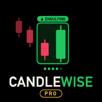
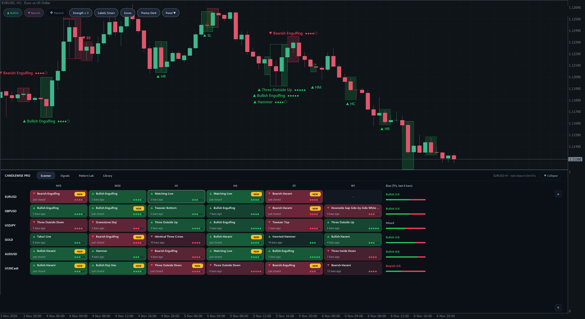
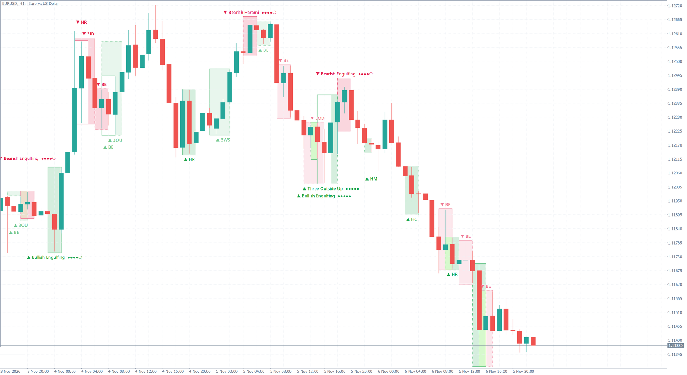
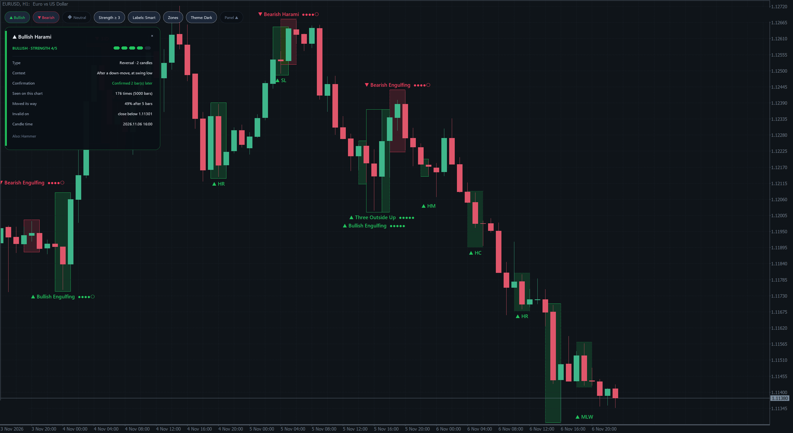
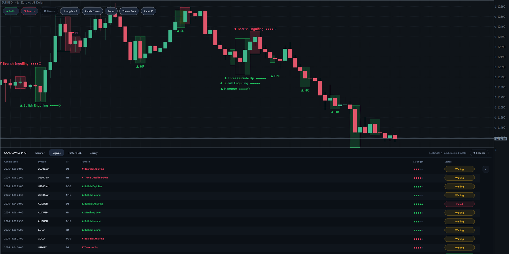
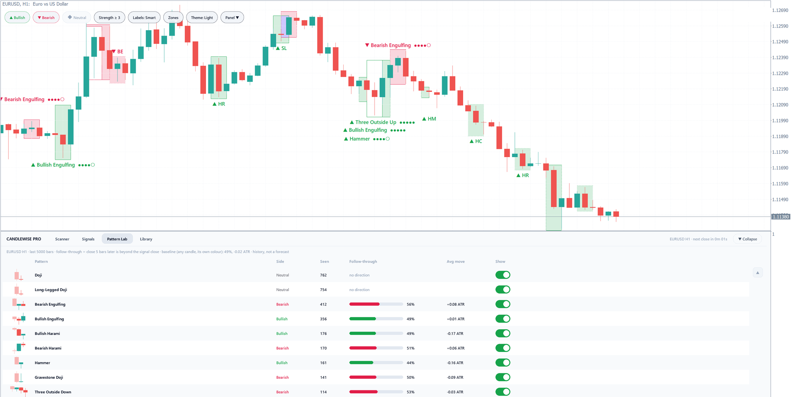
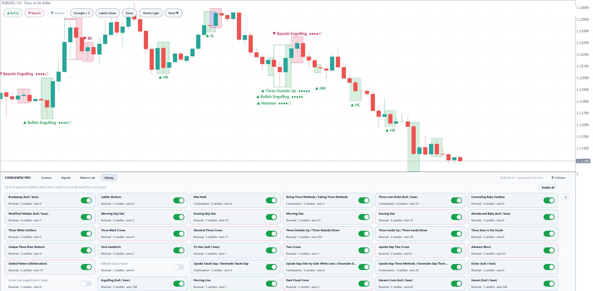

# Candlewise for MetaTrader 5

Candlestick pattern indicators for MetaTrader 5, in two editions:

- **[Candlewise Lite](https://www.mql5.com/en/market/product/207061)** (free): 22 classic candlestick patterns highlighted on your chart.
- **[Candlewise Pro](https://www.mql5.com/en/market/product/207067)** (paid): 63 patterns, a multi-market scanner, a signal feed, alerts and per-symbol pattern statistics.

This repository is the public home of the project: the roadmap, the change log, and the place to send feature requests. It contains no source code. The indicators are distributed only through the MQL5 Market.

## Editions

This table lists what version 1.00 contains today. Features that are still being built are on the [roadmap](ROADMAP.md).

| | Lite (free) | Pro |
|---|:---:|:---:|
| Candlestick patterns | 22 classic patterns | 63 patterns |
| Pattern zones and labels on the chart | ✓ | ✓ |
| Strength score (1–5) from the prior move and swing high/low | ✓ | ✓ |
| Confirmation status shown on each zone (waiting, confirmed, failed) | ✓ | ✓ |
| Light and dark themes; chart colours restored when you remove the indicator | ✓ | ✓ |
| On-chart toolbar: bullish / bearish / indecision filters, minimum strength, labels, zones, theme | | ✓ |
| Pattern card: context, confirmation, history on this symbol, invalidation price | | ✓ |
| Preview of a pattern forming on the open candle, marked "forming" | | ✓ |
| Scanner: up to 12 symbols × 9 timeframes; click a cell to open that chart | | ✓ |
| Signal feed with live status | | ✓ |
| Pattern Lab: how each pattern behaved on this symbol, next to a baseline for any candle | | ✓ |
| Library: switch any of the 63 patterns on or off | | ✓ |
| Alerts on candle close: popup, sound, push notification, email | | ✓ |
| Pattern data your own Expert Advisor can read with `iCustom` (no EA included) | | ✓ |

Pattern rules follow the open-source TA-Lib definitions, which are based on Steve Nison's *Japanese Candlestick Charting Techniques* and Gregory Morris's *Candlestick Charting Explained*. Tweezer Top and Tweezer Bottom follow Thomas Bulkowski's *Encyclopedia of Candlestick Charts*.

Patterns are marked on closed candles, so a marked pattern does not disappear later. The only exception is Pro's optional preview of the open candle, which is labelled "forming" and can change until the candle closes.

Pattern statistics shown by the indicator describe past behaviour on your chart. They are not a forecast, and candlestick patterns are not trading advice.

## Screenshots

| Candlewise Lite, dark | Candlewise Lite, light |
|---|---|
|  |  |

| Pro: pattern card | Pro: signal feed |
|---|---|
|  |  |

| Pro: Pattern Lab | Pro: Library |
|---|---|
|  |  |

## Get it

- Candlewise Lite (free), listed on the MQL5 Market as "Candlewise": https://www.mql5.com/en/market/product/207061
- Candlewise Pro: https://www.mql5.com/en/market/product/207067

Install from the Market page, or in MetaTrader 5 open the Market tab in the Toolbox window and search for Candlewise.

## Roadmap

See the [roadmap board](https://github.com/users/heniabida/projects/1) or [ROADMAP.md](ROADMAP.md) for what is being built and what comes next. Features appear in the table above only once they are released.

## Request a feature

Open a **Product feature request** from the [Issues](../../issues/new/choose) tab and fill in the form. One request per form helps the review.

How requests are handled:

1. A new request gets the labels `pfr` and `needs-review`.
2. I read every request and reply in the issue.
3. A request moves to `planned`, `in-progress` and `shipped` as work goes on, or is closed as `declined` or `duplicate` with a short reason.
4. Accepted requests are added to the roadmap with their issue number.

Only the project owner changes labels, the roadmap and releases.

## Contributions

This is a closed-source project with a single maintainer. Pull requests are not accepted and are closed automatically. Please use a feature request instead.

## Support

For questions about a purchase, write to me through my MQL5 profile.

---

© Candlewise. All rights reserved. The indicators, images and text in this repository may not be copied or redistributed.
