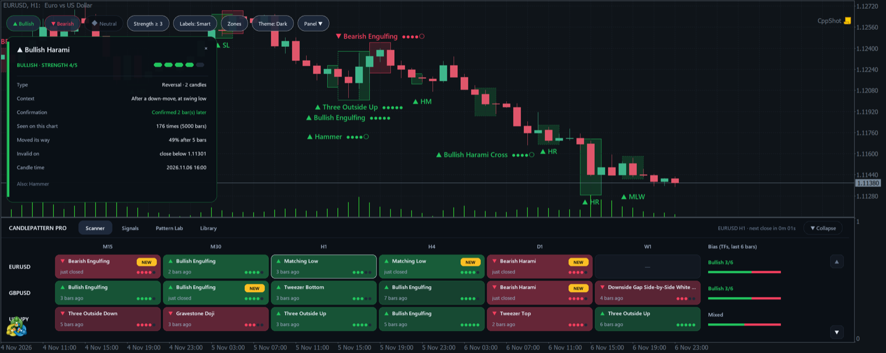
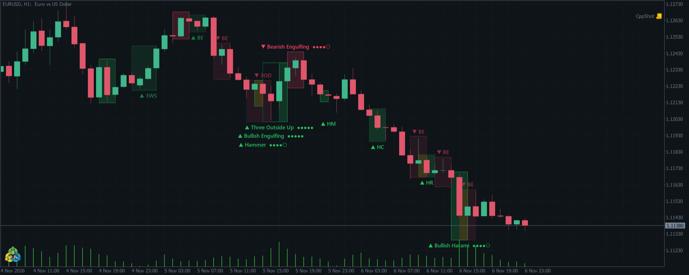
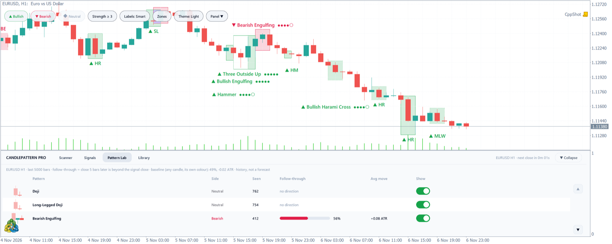

# CandlePattern for MetaTrader 5

Candlestick pattern indicators for MetaTrader 5, in two editions:

- **CandlePattern Lite** (free): the classic candlestick patterns highlighted on your chart.
- **CandlePattern Pro** (paid): all 63 patterns, a multi-market scanner, a signal feed, alerts and per-symbol pattern statistics.

This repository is the public home of the project: the roadmap, the change log, and the place to send feature requests. It contains no source code. The indicators are distributed only through the MQL5 Market.

## Editions

| | Lite (free) | Pro |
|---|:---:|:---:|
| Candlestick patterns | 22 classic patterns | 63 patterns |
| Pattern zones and labels on the chart | ✓ | ✓ |
| Strength score (1–5) from trend and swing context | ✓ | ✓ |
| Confirmation status (waiting, confirmed, failed) | ✓ | ✓ |
| Light and dark themes | ✓ | ✓ |
| Values for Expert Advisors (`iCustom` buffers) | ✓ | ✓ |
| On-chart toolbar (filters, labels, theme) | | ✓ |
| Pattern card: context, confirmation, history on this symbol | | ✓ |
| Preview of the pattern forming on the open candle | | ✓ |
| Scanner: symbols × timeframes on one panel | | ✓ |
| Signal feed with live status | | ✓ |
| Pattern Lab: how each pattern behaved on this symbol | | ✓ |
| Library: switch any pattern on or off | | ✓ |
| Popup, push and email alerts | | ✓ |

Pattern rules follow the open-source TA-Lib definitions, which are based on Steve Nison's *Japanese Candlestick Charting Techniques* and Gregory Morris's *Candlestick Charting Explained*. Tweezer Top and Tweezer Bottom follow Thomas Bulkowski's *Encyclopedia of Candlestick Charts*. Every pattern is detected on closed candles only, so a marked pattern never disappears later.

Pattern statistics shown by the indicator describe past behaviour on your chart. They are not a forecast, and candlestick patterns are not trading advice.

| Lite | Pro, Pattern Lab |
|---|---|
|  |  |

## Get it

- CandlePattern Lite: MQL5 Market link coming with the first release.
- CandlePattern Pro: MQL5 Market link coming with the first release.

## Roadmap

See [ROADMAP.md](ROADMAP.md) for what is being built and what comes next. Many items come from what traders ask for in comments on similar indicators.

## Request a feature

Open a **Product feature request** from the [Issues](../../issues/new/choose) tab and fill in the form. One request per form helps the review.

How requests are handled:

1. A new request gets the labels `pfr` and `needs-review`.
2. I read every request and reply in the issue.
3. A request moves to `planned`, `in-progress` and `shipped` as work goes on, or is closed as `declined` or `duplicate` with a short reason.
4. Accepted requests are added to the roadmap with their issue number.

Only the project owner changes labels, the roadmap and releases.

## Contributions

This is a closed-source project with a single maintainer. Pull requests are not accepted and are closed automatically. Please use a feature request instead; good ideas are credited in the change log with your permission.

## Support

For questions about a purchase, write to me through my MQL5 profile.

---

© CandlePattern. All rights reserved. The indicators, images and text in this repository may not be copied or redistributed.
